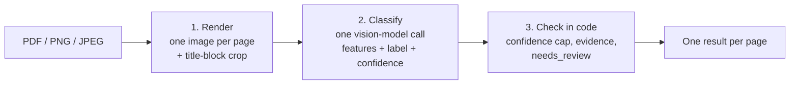

# PlanSense

PlanSense classifies construction drawings. You upload a PDF, PNG or JPEG, and for **each page** it decides whether the page is a construction plan and which discipline it belongs to:

`architectural` · `structural` · `electrical` · `plumbing` · `hvac_mechanical` · `civil_site` · `fire_safety` · `not_a_plan`

Each answer comes with a confidence score and the evidence read from the page (sheet title, sheet number, legend, what is drawn).

How it works: **one vision-model call per page on Amazon Bedrock** (Qwen3 VL 235B by default), through LangChain. The model reads the page, fills a structured form and gives the label and confidence in the same answer. It runs behind a **FastAPI** service with a small web page.

> The first version was a multimodal RAG pipeline (extractor → Titan embeddings + FAISS → decision model). It is kept as it was pushed in [`old/`](old/). [Why it was dropped](#why-no-rag) is explained below.

## Contents

- [How it works](#how-it-works)
- [Project structure](#project-structure)
- [Quick start](#quick-start)
- [Commands](#commands)
- [Evaluation](#evaluation)
- [Why no RAG](#why-no-rag)
- [What changed from the first version](#what-changed-from-the-first-version)
- [Troubleshooting](#troubleshooting)

## How it works


**Example result** (one item per page):

```json
{
  "file": "bundle.pdf",
  "page": 2,
  "is_plan": true,
  "label": "plumbing",
  "confidence": 0.95,
  "evidence": ["sheet title: FIRST FLOOR PLUMBING PLAN", "sheet number: P-1", "legend: cold water, hot water, floor drain"],
  "model_id": "qwen.qwen3-vl-235b-a22b",
  "latency_ms": 6900,
  "needs_review": false,
  "usage": {"input_tokens": 4566, "output_tokens": 333, "calls": 1}
}
```

## Project structure

```
app/
  app.py              FastAPI: POST /classify, GET /health, web page at /
  core/               config.py (settings from .env), schemas.py (PlanFeatures, PageResult)
  pipeline/           render.py (pages -> images), extract.py (prompt + model call),
                      llm.py (Bedrock client, structured output, retries),
                      main.py (classify_file + CLI)
  services/cost.py    token cost and usage log
  web/                index.html, style.css, app.js
scripts/
  check_bedrock.py    checks model access (text, image + tool use)
  download_data.py    builds data/test from the manifest
  eval/               run_eval.py, report.py, models.json, scenarios.json, results/
data/
  manifest.csv        source URL and licence of every test file
  test/               3 test pages per class (24)
  test_multipage/     5-page test PDF + expected labels
tests/                unit tests (no AWS calls)
iam/policy.json       least-privilege IAM policy (reference)
old/                  the first version (RAG), as pushed
```

## Quick start

You need Python 3.11+, an AWS account with Bedrock access, and a [Bedrock API key](https://docs.aws.amazon.com/bedrock/latest/userguide/api-keys.html). The key must be generated in the region you use.

```powershell
# 1. Install
py -3.11 -m venv .venv
.\.venv\Scripts\Activate.ps1          # macOS / Linux: source .venv/bin/activate
pip install -r requirements.txt

# 2. Configure: copy the template, then paste the API key
copy .env.example .env

# 3. Check Bedrock access
python -m scripts.check_bedrock

# 4. Get the test data (only needed for the evaluation; see the note below)
python -m scripts.download_data

# 5. Run the API and the web page
uvicorn app.app:app --reload          # open http://127.0.0.1:8000
```

The `.env`:

```ini
AWS_BEARER_TOKEN_BEDROCK=...          # key generated in ap-south-1
AWS_REGION=ap-south-1
MODEL_ID=qwen.qwen3-vl-235b-a22b
PRICE_IN=0.62                         # USD per 1M input tokens, used for cost figures
PRICE_OUT=3.13                        # USD per 1M output tokens
```

Optional settings, with their defaults: `REVIEW_THRESHOLD=0.6`, `NO_TITLE_CONFIDENCE_CAP=0.75`, `PAGE_WORKERS=3`, `MAX_IMAGE_BYTES=1000000`.

Any Bedrock vision model that supports tool use can be set as `MODEL_ID`. Set `PRICE_IN` / `PRICE_OUT` to its prices, otherwise the cost figures are wrong. Cross-region models need the inference-profile ID (for example `apac.amazon.nova-pro-v1:0`). If you change the model, also update the resource ARN in [iam/policy.json](iam/policy.json).

**The Google Maps screenshot.** One `not_a_plan` test page (`test_nap_03`) is a screenshot of Google Maps, with the map, the search bar and the zoom buttons visible. It isn't in the repository, because Google's terms don't allow redistributing it. Take a screenshot of any area in Google Maps and save it as **`data/local/google_maps_screenshot.png`** before running `download_data`. The other 23 files are downloaded from Wikimedia Commons.

## Commands

```powershell
# Classify a file from the command line (one JSON result per page)
python -m app.pipeline.main data\test_multipage\bundle.pdf
python -m app.pipeline.main plan.png --model apac.amazon.nova-pro-v1:0   # try another model

# Call the API
curl.exe -F "file=@data/test_multipage/bundle.pdf" "http://127.0.0.1:8000/classify"
curl.exe "http://127.0.0.1:8000/health"

# Unit tests (no AWS calls)
pytest

# Check access to other models
python -m scripts.check_bedrock --model apac.amazon.nova-pro-v1:0 moonshotai.kimi-k2.5

# Evaluation (see below)
python -m scripts.eval.run_eval --list                  # models and scenarios
python -m scripts.eval.run_eval                         # Qwen3 VL, both scenarios (~$0.20)
python -m scripts.eval.run_eval --model all             # every model in models.json
python -m scripts.eval.run_eval --model nova-pro --scenario title_hidden
python -m scripts.eval.report                           # writes results/report.md
```

`/classify` errors: **413** the file is larger than 20 MB. **415** it isn't a PDF, PNG or JPEG. **422** it's empty, corrupt, password-protected or longer than 20 pages. **503** (with `Retry-After`) Bedrock throttled every page. **504** Bedrock timed out. **502** every page failed for another reason, such as the model never returning a valid answer. If only some pages fail, the response is still 200 and those pages carry an `error` field.

## Evaluation

[scripts/eval/](scripts/eval/) runs the pipeline on the **24 test pages** (3 per class, none used while writing the prompt) and on the **5-page bundle PDF**. It runs two scenarios ([scenarios.json](scripts/eval/scenarios.json)):

- **`title_visible`**: the page as it is.
- **`title_hidden`**: the title-block corner is blanked out. This shows whether the model recognises the drawing itself or only reads the title.

For each model and scenario it reports:
- accuracy, macro-F1 and a confusion matrix;
- non-plan rejection rate;
- mean confidence;
- cost per 1,000 pages;
- p50 / p95 latency;
- format failures (retried calls);
- errors.

Model answers are cached in `results/_cache/`, so running again costs nothing. Models and their Mumbai prices are listed in [models.json](scripts/eval/models.json). `report.py` ranks the models in `results/report.md` and writes every per-page answer to `results/predictions.csv`.

## Why no RAG

The first version ([`old/`](old/)) was the RAG pipeline.

- **Retrieval fixed one page with the title visible, and none with it hidden.**
- **A better prompt made the extractor alone as accurate, at half the cost.**
- **The model mattered more than the pipeline:** Qwen3 VL alone got 24/24 in both scenarios at $3.87 per 1,000 pages.

A knowledge base would help with company-specific conventions or harder pages; `old/` is the starting point for that. Note that 24 pages is a small sample (one page ≈ 4 points of accuracy).

## What changed from the first version

- **Pipeline:** one model call per page instead of extract → retrieve → decide.
- **Evidence:** built in code from the extracted fields. Confidence is capped at 0.75 when no title is visible.
- **Images:** a 1 MB budget per image, so models other than Nova accept every page.
- **Removed:** retrieval, decision model, fast-path router, Titan embeddings, the knowledge base (`data/kb/`, `kb_index/`) and the `use_rag` / `fast_path` options.
- **Evaluation:** compares models with the title visible and hidden.
- **`.env`:** `MODEL_ID`, `PRICE_IN` and `PRICE_OUT` replace `SONNET_MODEL_ID`, `OPUS_MODEL_ID`, `EMBED_MODEL_ID` and the rest.

## Troubleshooting

| Problem | Fix |
|---|---|
| `Missing required setting MODEL_ID` | `.env` is missing or uses the old names. Copy `.env.example` again |
| `AccessDeniedException` | Enable the model in the Bedrock console, or check the key's permissions |
| `UnrecognizedClientException` / `ExpiredTokenException` | The API key has expired (12 h max) or is wrong. Generate a new one, in the same region as `AWS_REGION` |
| `ValidationException` on a model ID | Wrong ID or not offered in the region. Cross-region models need the `apac.…` profile ID |
| `length limit exceeded` | The request is over ~2.5 MB. Keep `MAX_IMAGE_BYTES` at 1000000 |
| `ThrottlingException` / HTTP 503 | Bedrock quota reached. Wait, or lower `PAGE_WORKERS` (`--workers` for the evaluation) |
| Wrong cost figures | `PRICE_IN` / `PRICE_OUT` don't match the model. See `scripts/eval/models.json` |
| `[FAIL] … test_nap_03` in `download_data` | Save a Google Maps screenshot as `data/local/google_maps_screenshot.png` |
| `Activate.ps1 cannot be loaded` | Run `Set-ExecutionPolicy -Scope CurrentUser RemoteSigned` once |
