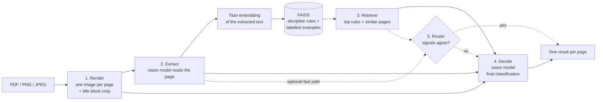

# PlanSense

PlanSense classifies construction drawings. You upload a PDF, PNG or JPEG, and for **each page** it decides whether the page is a construction plan and which discipline it belongs to:

`architectural` · `structural` · `electrical` · `plumbing` · `hvac_mechanical` · `civil_site` · `fire_safety` · `not_a_plan`

Each answer comes with a confidence score and the knowledge-base documents that were used to reach it.

How it works: a multimodal RAG pipeline built with **LangChain on Amazon Bedrock**.

1. A vision model reads the page.
2. **Titan embeddings + FAISS** retrieve the matching discipline rules and similar labelled pages.
3. A second model makes the final decision.

It runs behind a **FastAPI** service with a small web page. The evaluation, the results and the current limitations are covered in the separate PDF report.

## Contents

- [How it works](#how-it-works)
- [Project structure](#project-structure)
- [Quick start](#quick-start)
- [Troubleshooting](#troubleshooting)

## How it works



## Project structure

```
app/
  app.py              FastAPI: POST /classify, GET /health, web page at /
  core/               config.py (settings), schemas.py (Pydantic models)
  pipeline/           render, extract, retrieval, decide, router, llm (Bedrock clients),
                      main (classify_file + CLI)
  services/cost.py    token cost and usage log
  web/                index.html, style.css, app.js
scripts/
  check_bedrock.py    checks model access (text, image + tool, embedding)
  download_data.py    builds data/ from the manifest
  ingest_kb.py        builds the FAISS index (kb_index/)
  check_retrieval.py  offline retrieval quality check
  try_decide.py       one page, with vs without RAG
  eval/               run_eval.py (scenarios), report.py (comparison), results/
data/
  manifest.csv        source URL and licence of every file
  kb/                 disciplines.md (rules) + 5 example pages per class
  kb_features/        cached extractions of the KB pages
  test/               3 test pages per class
  test_multipage/     5-page test PDF + expected labels
tests/                unit tests (no AWS calls)
iam/policy.json       least-privilege IAM policy (reference)
```

## Quick start

You need Python 3.11+, an AWS account with Bedrock access, and a [Bedrock API key](https://docs.aws.amazon.com/bedrock/latest/userguide/api-keys.html). The key must be generated in the region you use.

```powershell
# 1. Install
py -3.11 -m venv .venv
.\.venv\Scripts\Activate.ps1          # macOS / Linux: source .venv/bin/activate
pip install -r requirements.txt

# 2. Configure: copy the template, then set the API key, region and model IDs
copy .env.example .env

# 3. Check Bedrock access
python -m scripts.check_bedrock

# 4. Download the data (64 public files)
python -m scripts.download_data

# 5. Build the knowledge base
python -m scripts.ingest_kb

# 6. Run the API and the web page
uvicorn app.app:app --reload          # open http://127.0.0.1:8000
```

The `.env` used for the evaluation:

```ini
AWS_BEARER_TOKEN_BEDROCK=...                 # key generated in ap-south-1
AWS_REGION=ap-south-1
EMBED_REGION=ap-south-1
SONNET_MODEL_ID=apac.amazon.nova-pro-v1:0    # extractor
OPUS_MODEL_ID=apac.amazon.nova-pro-v1:0      # decision model
EMBED_MODEL_ID=amazon.titan-embed-text-v2:0
```

`SONNET_MODEL_ID` and `OPUS_MODEL_ID` set the **extractor** and **decision model**. Any Bedrock vision model that supports tool use can fill either one. After switching models, run `python -m scripts.ingest_kb --refresh`.

**Other commands**

```powershell
# Classify a file from the command line
python -m app.pipeline.main data\test_multipage\bundle.pdf

# Call the API
curl.exe -F "file=@data/test_multipage/bundle.pdf" "http://127.0.0.1:8000/classify"

# Unit tests (no AWS calls)
pytest

# Evaluation: run the scenarios, then build the comparison report
python -m scripts.eval.run_eval --scenario all
python -m scripts.eval.report
```

## Troubleshooting

| Problem | Cause and fix |
|---|---|
| `AccessDeniedException … INVALID_PAYMENT_INSTRUMENT` | Anthropic models on Bedrock are sold through AWS Marketplace, and the account has no valid payment method. Fix the billing, or use an Amazon model such as Nova Pro in `.env` |
| `AccessDeniedException` (other) | The model is not enabled for the account, or the key lacks permission. Open the model once in the Bedrock playground, or ask an admin to check the policy |
| `UnrecognizedClientException` / `ExpiredTokenException` | The API key is invalid or has expired (short-term keys last at most 12 h). Generate a new one |
| Calls fail right after changing region | API keys only work in the region where they were generated. Create a key in the new region |
| `ValidationException` on a model ID | Wrong ID, or the model isn't offered in that region. Cross-region models need the inference-profile ID (`apac.…`, `eu.…`, `us.…`). Models such as Titan or Qwen use the plain model ID |
| `Failed to buffer the request body: length limit exceeded` (playground) | The image is too large for the playground. The pipeline resizes pages before sending them, so this doesn't happen in the app |
| `ModelErrorException … invalid sequence as part of ToolUse` | Nova occasionally produces a broken tool call. The pipeline retries and then falls back to plain JSON. If a page still fails, run it again |
| `ThrottlingException`, or HTTP 503 from `/classify` | The Bedrock quota was reached. Wait for the `Retry-After` time, or lower `PAGE_WORKERS` |
| HTTP 503 "Knowledge base index not built" / `/health` shows `index_loaded: false` | Run `python -m scripts.ingest_kb` |
| Titan fails in your region | Set `EMBED_REGION` to a region that offers Titan Text Embeddings V2. `check_bedrock` suggests one |
| HTTP 413 / 415 / 422 | 413: the file is larger than 20 MB. 415: it isn't a PDF, PNG or JPEG. 422: it's empty, corrupt, password-protected, or longer than 20 pages |
| A page takes ~20 s | Expected: each page makes two model calls, one after the other. Pages of one PDF run 3 at a time (`PAGE_WORKERS`) |
| `Activate.ps1 cannot be loaded` (PowerShell) | Run `Set-ExecutionPolicy -Scope CurrentUser RemoteSigned` once |
| Wrong Python version | The project needs 3.11+. Create the venv with `py -3.11 -m venv .venv` |
| Changes to `disciplines.md` have no effect | Rebuild the index: `python -m scripts.ingest_kb`. After changing the extractor model or prompt, use `--refresh` |
